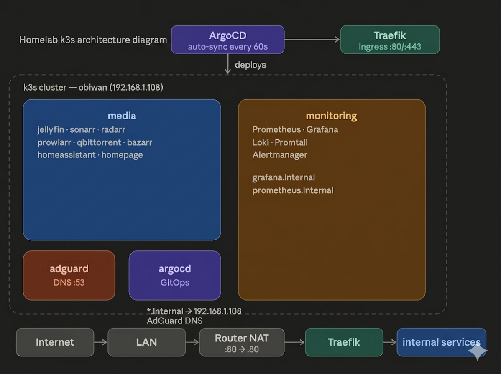

# Homelab K8s

Personal homelab running on k3s with GitOps via ArgoCD.

## Stack

| Service | Description | URL |
|---------|-------------|-----|
| Jellyfin | Media Server | http://jellyfin.internal |
| Sonarr | TV Management | http://sonarr.internal |
| Radarr | Movie Management | http://radarr.internal |
| Prowlarr | Indexer Management | http://prowlarr.internal |
| qBittorrent | Torrent Client | http://qbit.internal |
| Bazarr | Subtitle Management | http://bazarr.internal |
| Home Assistant | Home Automation | http://ha.internal |
| Homepage | Dashboard | http://homepage.internal |
| AdGuard Home | DNS Ad Blocker | http://adguard.internal |
| ArgoCD | GitOps | http://argocd.internal |
| Grafana | Monitoring | http://grafana.internal |
| Prometheus | Metrics | http://prometheus.internal |

## Architecture

Your homelab runs a declarative GitOps engine inside a single-node K3s context, managing structured tenant isolation across namespaces. Local DNS resolutions point wildcard internal traffic directly to the host IP, where Traefik handles Layer 7 route matching.

## Bootstrap a fresh cluster

### 1. Install k3s
curl -sfL https://get.k3s.io | sh -
echo 'write-kubeconfig-mode: "0644"' | sudo tee /etc/rancher/k3s/config.yaml
sudo systemctl restart k3s

### 2. Create required data directories
mkdir -p /home/obiwan/k8s_data/jellyfin/config
mkdir -p /home/obiwan/k8s_data/jellyfin/cache
mkdir -p /home/obiwan/k8s_data/sonarr/config
mkdir -p /home/obiwan/k8s_data/radarr/config
mkdir -p /home/obiwan/k8s_data/prowlarr/config
mkdir -p /home/obiwan/k8s_data/qbittorrent/config
mkdir -p /home/obiwan/k8s_data/bazarr/config
mkdir -p /home/obiwan/k8s_data/homeassistant
mkdir -p /home/obiwan/k8s_data/homepage/config/icons
mkdir -p /home/obiwan/k8s_data/adguardhome/conf
mkdir -p /home/obiwan/k8s_data/adguardhome/work
mkdir -p /home/obiwan/movies
mkdir -p /home/obiwan/tv
mkdir -p /home/obiwan/media/downloads

### 3. Restore backups (if rebuilding)
#### Jellyfin
cp jellyfin-backup-YYYYMMDD.zip /home/obiwan/k8s_data/jellyfin/config/data/data/backups/
sudo chown -R 1000:1000 /home/obiwan/k8s_data/jellyfin/config

#### Sonarr/Radarr/Prowlarr
cp sonarr_backup.zip /home/obiwan/k8s_data/sonarr/config/Backups/manual/
cp radarr_backup.zip /home/obiwan/k8s_data/radarr/config/Backups/manual/
cp prowlarr_backup.zip /home/obiwan/k8s_data/prowlarr/config/Backups/manual/

#### Bazarr
cp bazarr_backup.zip /home/obiwan/k8s_data/bazarr/backup/

#### Home Assistant
cp -r /path/to/old/homeassistant/config /home/obiwan/k8s_data/homeassistant/
sudo chown -R obiwan:obiwan /home/obiwan/k8s_data/homeassistant/

### 4. Bootstrap ArgoCD
kubectl apply -k bootstrap/argocd/

### 5. Add GitHub repo secret
kubectl create secret generic homelab-repo \
  --from-literal=type=git \
  --from-literal=url=https://github.com/kbdevops/homelab-k8s \
  --from-literal=username=kbdevops \
  --from-literal=password=YOUR_GITHUB_TOKEN \
  -n argocd
kubectl label secret -n argocd homelab-repo argocd.argoproj.io/secret-type=repository

### 6. ArgoCD deploys everything automatically
ArgoCD watches the repo and deploys:
- base/ -> media + adguard namespaces
- bootstrap/monitoring/ -> monitoring namespace

## Data Layout

/home/obiwan/k8s_data/    - All service config (backed up)
/home/obiwan/movies/      - Movie files
/home/obiwan/tv/          - TV show files
/home/obiwan/media/       - Downloads directory

## Monitoring

- Grafana: http://grafana.internal (obiwan/kenobi)
- Prometheus: http://prometheus.internal
- Dashboards: Node Exporter, Kubernetes Pods, ArgoCD, Traefik, Jellyfin Traffic
- Logs: Loki + Promtail collecting all pod logs
- Jellyfin traffic dashboard shows source IPs, response codes, slow requests

## AdGuard DNS Rewrites

Point these to 192.168.1.108 in AdGuard:
- jellyfin.internal
- sonarr.internal
- radarr.internal
- prowlarr.internal
- qbit.internal
- bazarr.internal
- ha.internal
- homepage.internal
- adguard.internal
- argocd.internal
- grafana.internal
- prometheus.internal

## Router

- Primary DNS: 192.168.1.108 (AdGuard)
- Port forward: 80 -> 192.168.1.108:80 (Traefik)
- External access: http://161.8.205.5 -> Jellyfin (catch-all)

## Credentials

- ArgoCD: admin / (reset via kubectl patch if forgotten)
- Grafana: obiwan / kenobi
README

cd ~/homelab-k8s
git add .
git commit -m "docs: update README with monitoring stack and full architecture"
git push origin main